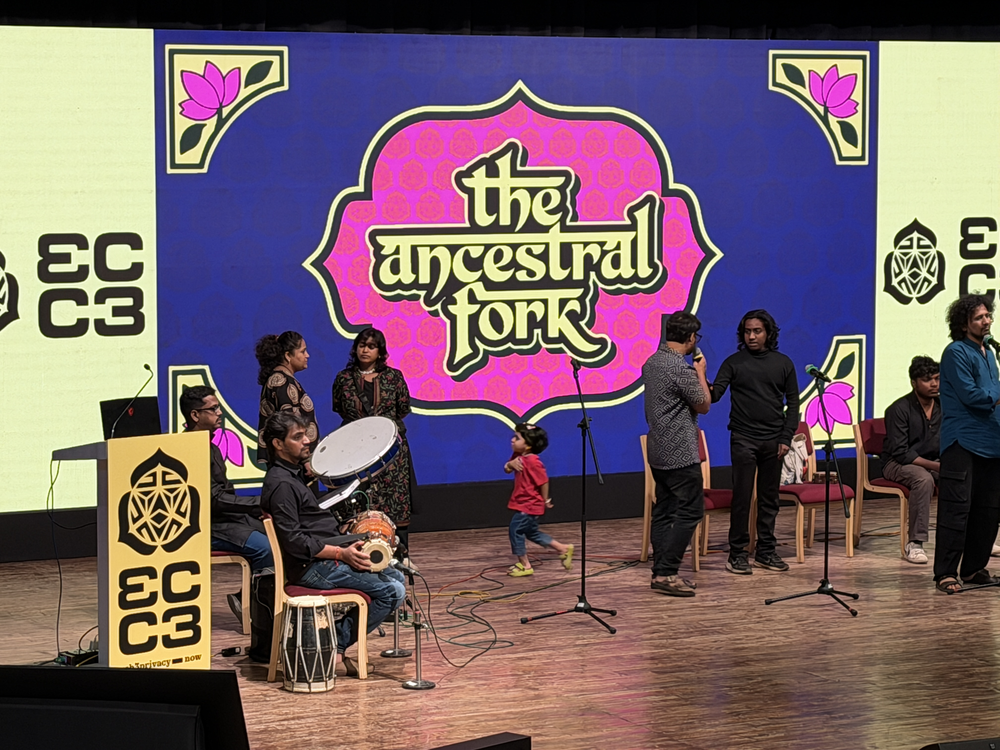
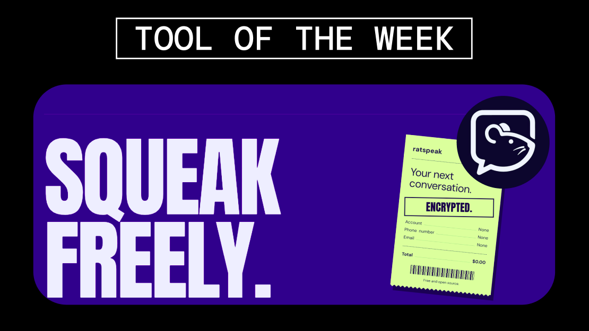

Good Monday and Happy Diwali, friends of privacy!

Cypherpunk Congress and DevCon week behind us and we are here with fresh news! This week’s newsletter covers private payments, decentralized communications, surveillance networks, personalized pricing and AI governance.

As our Tool of the Week, meet Ratspeak—an account-free, encrypted messenger that works across the internet, Wi-Fi, Bluetooth and LoRa radio, even when conventional infrastructure is unavailable.

---

---
### Tool of the Week
- [Ratspeak](https://ratspeak.org/)
---
### Insights
- [Brume launches on Solana and opens its token presale](https://presale.brume.tech/)
- [Ratspeak adopts a modified MIT license that prohibits harmful use and AI training](https://docs.ratspeak.org/docs/reference/licenses)
- [Signal shows how collecting minimal user data limits what it can surrender to authorities](https://signal.org/bigbrother/district-of-columbia-2/)
- [Zcash activates NU7 to make private payments faster and more scalable](https://www.coindesk.com/tech/2026/11/06/zcash-s-landmark-nu7-upgrade-goes-live-speeding-up-private-payments)
- [Mullvad Browser 16 adds Quad9 DNS and stronger window-title privacy](https://cyberinsider.com/mullvad-browser-16-quad9-dns-window-title-privacy/)

---
### Knowledge
- [Future of Privacy Forum responds to the FTC’s proposed rules for personalized pricing](https://fpf.org/resource/fpf-submits-comments-in-response-to-the-federal-trade-commissions-request-for-feedback-on-its-proposed-enforcement-policy-statement-regarding-personalized-pricing/)
- [Privacy leaders discuss coordinated incident response across the crypto ecosystem](https://www.projectglitch.xyz/p/coordinating-crypto-incident-response-dc-privacy-summit-roundtable)
- [US Democrats begin shaping AI-safety strategies for the 2028 presidential race](https://www.politico.com/news/2026/11/09/democrats-2028-brainstorm-ai-safety-01155925)
- [Funding the Commons explores how institutions must be redesigned for the age of AI](https://x.com/FundingCommons/status/2119762677954232335)
- [Lawsuits challenge the legality of Flock’s nationwide license-plate surveillance network](https://www.reuters.com/legal/government/flock-lawsuits-test-legal-limits-license-plate-reader-networks-2026-11-09/)

---

### Inspiration: Going On(Line) an offering of media from the web
- [Get the book The Politics of Privacy: Autonomy and Power in the Digital Age](https://web3privacynow.metalabel.com/politicsofprivacy?variantId=3)
- [Check the State of Decentralised Privacy report](https://web3privacy.info/projects/state-of-decentralized-privacy-report)
- [The Digital Independence They Don't Want You To Have by Naomi Brockwell](https://www.youtube.com/watch?v=YZm4NQyk-jU)
- [Web3 Privacy Now courses in our Academy](https://academy.web3privacy.info/)
---

### Inspiration: Going Off(Line) an offering of IRL events 
*(new/changes in **bold**)*
* Nov 12 - [Privacy Space](https://privacyspace.eu/) - Leamington Spa, United Kingdom
* Nov 13–14 - [SEEDIG 11 — South Eastern European Dialogue on Internet Governance](https://seedig.net/seedig-11/) - Sarajevo, Bosnia and Herzegovina
* Nov 15–17 - [Solana Breakpoint 2026](https://solana.com/breakpoint) - London, United Kingdom
* Nov 16–19 - [48th Global Privacy Assembly Annual Conference](https://globalprivacyassembly.com/48th-gpa-annual-conference/) - Brussels, Belgium
* Nov 16–19 - [IAPP Europe Congress 2026](https://www.iapp.org/conference/iapp-europe-congress) - Brussels, Belgium
* Nov 20–21 - [IXH26 — Italian XRPL Hackathon](https://hackathons.xrpl-commons.org/hackathons/ixh26-italian-xrpl-hackathon-4b11386b) - Bari, Italy
* Nov 30–Dec 5 - [Ulaanbaatar Blockchain Week 2026](https://www.ubblockchainweek.net/) - Ulaanbaatar, Mongolia
* Dec 2 - [Data Protection & Privacy Summit 2026](https://ciso.economictimes.indiatimes.com/data-protection-privacy-summit) - Mumbai, India
* Dec 2 & 9 - [State of the Onion 2026](https://blog.torproject.org/event/) - Online
* Dec 3–4 - [SantaCrypt 2026](https://mkb.tns.cz/cfp.en.html) - Prague, Czech Republic
* Dec 7 - [Future Cryptography 2026](https://chess-eu.cs.ut.ee/event/future-cryptography-2026-brussels-building-digital-trust/) - Brussels, Belgium
* Dec 7–10 - [Black Hat Europe 2026](https://blackhat.com/europe/) - London, United Kingdom
* Dec 9–12 - [Blockchain Kaigi 2026](https://www.blockchainkyoto.org/en/bck26) - Tokyo, Japan
* Dec 10–11 - [International Digital Rights Days](https://edri.org/take-action/events/international-digital-rights-days/) - Worldwide
* Dec 11 - [Product Cybersecurity: Making the Cyber Resilience Act a Reality](https://www.enisa.europa.eu/events/product-cybersecurity-making-cra-a-reality) - Brussels, Belgium & Online
* Dec 14–18 - [Internet Governance Forum 2026](https://www.intgovforum.org/en) - Nairobi, Kenya
* Dec 16–19 - [SPACE 2026 — Security, Privacy and Applied Cryptographic Engineering](https://space2026.cdacb.in/) - Bengaluru, India
* Dec 27–30 - [40C3 — 40th Chaos Communication Congress](https://events.ccc.de/congress/2026/infos/) - Hamburg, Germany
* Jan 30–31, 2027 - [FOSDEM 2027](https://fosdem.org/2027/) - Brussels, Belgium
