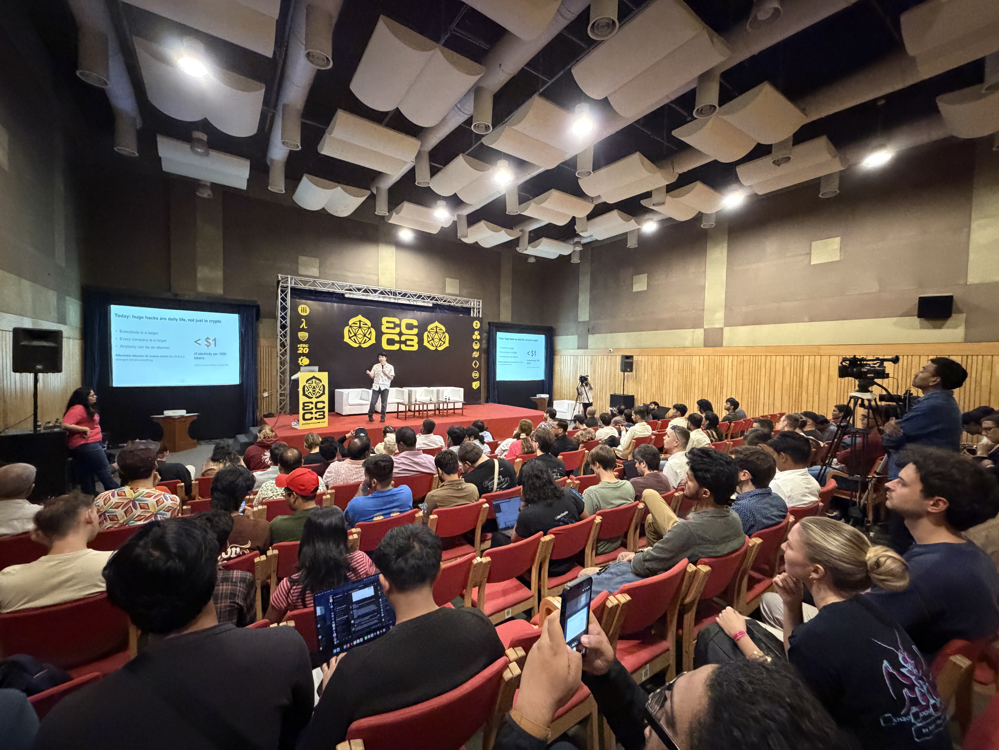
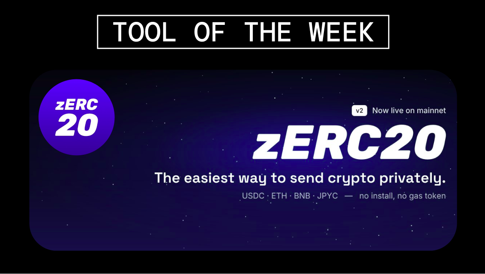

---

Good Monday, friends of privacy!

A new week has started, and it’s time to look back at what happened across privacy and digital freedom. This edition features private crypto payments, 
Meta tracking protection, SimpleX v7.1, institutional Ethereum privacy, AI use by intelligence agencies, digital-rights training and threats facing investigative journalism. 

Our Tool of the Week is zERC20—a zero-knowledge payment protocol designed to make privacy part of everyday crypto use.

---

---
### Tool of the week
- [Check out zERC20, a non-custodial payment protocol for privately holding and transferring tokens using zK proofs](https://zerc20.io/) 

---
### Insights
- [zERC20 argues that privacy should be built into everyday crypto payments](https://zerc20.io/blog/privacy-shouldnt-be-a-place-you-go)
- [Brave strips hidden Meta tracking identifiers from Facebook and Instagram photos](https://cyberinsider.com/brave-removes-meta-tracking-identifiers-facebook-instagram-photos/)
- [SimpleX v7.1 introduces larger file transfers, safer channels and full Markdown support](https://x.com/SimpleXChat/status/2122053388477342126)
- [Ethereum Institutional explores how privacy can bring more financial activity onchain](https://ethereum-institutional.github.io/ei-digitalassets/privacy/)
- [Bermuda demonstrates policy-aware private USDC transfers on Rollup X](https://x.com/etheconomiczone/status/2121248833812217865)

---
### Knowledge
- [Exploit turns the struggle between independent journalism and tech oligarchy into a comic thriller](https://www.404media.co/this-comic-kills-technofascists/)
- [SFLC.in opens applications for its Digital Defender Network training program](https://x.com/SFLCin/status/2122238881789853948)
- [Privacy International examines regulatory gaps surrounding AI use by UK intelligence agencies](https://privacyinternational.org/report/5880/artifical-intelligence-agencies-use-and-regulation-ai-uk-intelligence-agencies/)
- [Former Anthropic researcher Jacob Coxon reflects on pursuing AI safety from inside and outside major labs](https://www.youtube.com/watch?v=UggJMQskOj8)
- [Panama investigates a bombing attack on investigative journalist Rolando Rodríguez’s home](https://apnews.com/article/dca67b7bdfc622850384bc47a08e9484)
---

### Inspiration: Going On(Line) an offering of media from the web
- [Get the book The Politics of Privacy: Autonomy and Power in the Digital Age](https://web3privacynow.metalabel.com/politicsofprivacy?variantId=3)
- [Why a Perfect Internet Is Dangerous | Pranesh Prakash, ex-Centre for Internet and Society](https://youtu.be/5LnhFGhsoCk)
- [Check the State of Decentralised Privacy report](https://web3privacy.info/projects/state-of-decentralized-privacy-report)
- [The Digital Independence They Don't Want You To Have by Naomi Brockwell](https://www.youtube.com/watch?v=YZm4NQyk-jU)
- [Web3 Privacy Now courses in our Academy](https://academy.web3privacy.info/)
---

### Inspiration: Going Off(Line) an offering of IRL events 
*(new/changes in **bold**)*
* Nov 15–17 - [Solana Breakpoint 2026](https://solana.com/breakpoint) - London, United Kingdom
* Nov 16–19 - [48th Global Privacy Assembly Annual Conference](https://globalprivacyassembly.com/48th-gpa-annual-conference/) - Brussels, Belgium
* Nov 16–19 - [IAPP Europe Congress 2026](https://www.iapp.org/conference/iapp-europe-congress) - Brussels, Belgium
* Nov 20–21 - [IXH26 — Italian XRPL Hackathon](https://hackathons.xrpl-commons.org/hackathons/ixh26-italian-xrpl-hackathon-4b11386b) - Bari, Italy
* Nov 30–Dec 5 - [Ulaanbaatar Blockchain Week 2026](https://www.ubblockchainweek.net/) - Ulaanbaatar, Mongolia
* Dec 2 - [Data Protection & Privacy Summit 2026](https://ciso.economictimes.indiatimes.com/data-protection-privacy-summit) - Mumbai, India
* Dec 2 & 9 - [State of the Onion 2026](https://blog.torproject.org/event/) - Online
* Dec 3–4 - [SantaCrypt 2026](https://mkb.tns.cz/cfp.en.html) - Prague, Czech Republic
* Dec 7 - [Future Cryptography 2026](https://chess-eu.cs.ut.ee/event/future-cryptography-2026-brussels-building-digital-trust/) - Brussels, Belgium
* Dec 7–10 - [Black Hat Europe 2026](https://blackhat.com/europe/) - London, United Kingdom
* Dec 9–12 - [Blockchain Kaigi 2026](https://www.blockchainkyoto.org/en/bck26) - Tokyo, Japan
* Dec 10–11 - [International Digital Rights Days](https://edri.org/take-action/events/international-digital-rights-days/) - Worldwide
* Dec 11 - [Product Cybersecurity: Making the Cyber Resilience Act a Reality](https://www.enisa.europa.eu/events/product-cybersecurity-making-cra-a-reality) - Brussels, Belgium & Online
* Dec 14–18 - [Internet Governance Forum 2026](https://www.intgovforum.org/en) - Nairobi, Kenya
* Dec 16–19 - [SPACE 2026 — Security, Privacy and Applied Cryptographic Engineering](https://space2026.cdacb.in/) - Bengaluru, India
* Dec 27–30 - [40C3 — 40th Chaos Communication Congress](https://events.ccc.de/congress/2026/infos/) - Hamburg, Germany
* Jan 30–31, 2027 - [FOSDEM 2027](https://fosdem.org/2027/) - Brussels, Belgium
