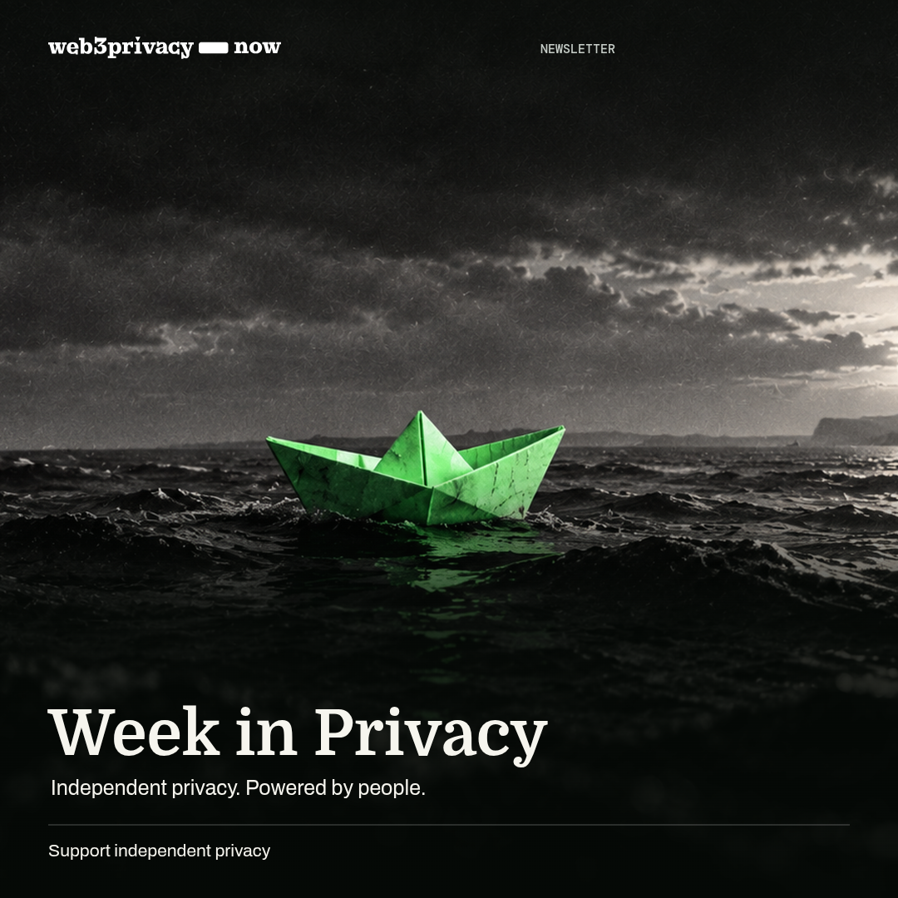

---

Good Monday, friends of privacy!

It might be hard to believe, but release of GTA 6 wasn't the only thing worth your attention. Private messaging, AI privacy risks, open AI models, facial recognition, telecom regulation and Jordan’s Telegram ban - all in this week's newsletter for you.

Our Tool of the Week is SimpleX Chat v7.1—a private messenger without user IDs.

---

---
### Tool of the week
- [Check out SimpleX Chat v7.1](https://simplex.chat/)
---
### Insights
- [SimpleX details its Trail of Bits security audit and security process](https://simplex.chat/blog/20261121-simplex-chat-security-audit-trail-of-bits-security-process.html)
- [Signal explains how its nonprofit model keeps privacy ahead of profit](https://x.com/signalapp/status/2122392859550867956)
- [NEAR introduces SHIELD for transaction screening across NEAR Intents](https://x.com/NEARProtocol/status/2123416306644885825)
- [Polkadot App offers a look under the hood at Web3 Summit](https://www.youtube.com/watch?v=iOcUvCplz_k)
- [Pirate Face uses torrents to keep open AI models available beyond any single platform](https://pirateface.co/)
- [Signal blocks operating-system AI agents from accessing private conversations](https://signal.org/blog/protecting-your-privacy/)

---
### Knowledge
- [Privacy International maps the spread of facial recognition technology in schools](https://maps.privacyinternational.org/)
- [Nurses warn that workplace AI can create more work instead of reducing it](https://news.bloomberglaw.com/labor-relations/union-nurses-tell-researchers-that-ai-can-make-their-jobs-harder)
- [Sharing everyday photos without consent can expose women in Pakistan to serious harm](https://www.theguardian.com/global-development/2026/nov/18/dangerous-intimate-images-algorithms-selfie-platforms)
- [Internet Freedom Foundation challenges India’s rushed consultation on telecom AI rules](https://internetfreedom.in/four-weeks-is-not-enough-iff-writes-to-trai-on-telecom-ai-guidelines/)
- [UN and Barbados convene a global summit as AI risks outpace countries’ ability to respond](https://news.un.org/en/story/2026/11/1168854)
- [Jordan blocks Telegram over claims that the platform is contributing to radicalisation](https://www.dw.com/en/jordan-bans-telegram-app-over-radicalisation-claims/a-79956706)

---

### Inspiration: Going On(Line) an offering of media from the web
- [Get the book The Politics of Privacy: Autonomy and Power in the Digital Age](https://web3privacynow.metalabel.com/politicsofprivacy?variantId=3)
- [Why a Perfect Internet Is Dangerous | Pranesh Prakash, ex-Centre for Internet and Society](https://youtu.be/5LnhFGhsoCk)
- [Check the State of Decentralised Privacy report](https://web3privacy.info/projects/state-of-decentralized-privacy-report)
- [The Digital Independence They Don't Want You To Have by Naomi Brockwell](https://www.youtube.com/watch?v=YZm4NQyk-jU)
- [Web3 Privacy Now courses in our Academy](https://academy.web3privacy.info/)
---

### Inspiration: Going Off(Line) an offering of IRL events 
*(new/changes in **bold**)*
* Nov 30–Dec 5 - [Ulaanbaatar Blockchain Week 2026](https://www.ubblockchainweek.net/) - Ulaanbaatar, Mongolia
* Dec 2 - [Data Protection & Privacy Summit 2026](https://ciso.economictimes.indiatimes.com/data-protection-privacy-summit) - Mumbai, India
* Dec 2 & 9 - [State of the Onion 2026](https://blog.torproject.org/event/) - Online
* Dec 3–4 - [SantaCrypt 2026](https://mkb.tns.cz/cfp.en.html) - Prague, Czech Republic
* Dec 7 - [Future Cryptography 2026](https://chess-eu.cs.ut.ee/event/future-cryptography-2026-brussels-building-digital-trust/) - Brussels, Belgium
* Dec 7–10 - [Black Hat Europe 2026](https://blackhat.com/europe/) - London, United Kingdom
* Dec 9–12 - [Blockchain Kaigi 2026](https://www.blockchainkyoto.org/en/bck26) - Tokyo, Japan
* Dec 10–11 - [International Digital Rights Days](https://edri.org/take-action/events/international-digital-rights-days/) - Worldwide
* Dec 11 - [Product Cybersecurity: Making the Cyber Resilience Act a Reality](https://www.enisa.europa.eu/events/product-cybersecurity-making-cra-a-reality) - Brussels, Belgium & Online
* Dec 14–18 - [Internet Governance Forum 2026](https://www.intgovforum.org/en) - Nairobi, Kenya
* Dec 16–19 - [SPACE 2026 — Security, Privacy and Applied Cryptographic Engineering](https://space2026.cdacb.in/) - Bengaluru, India
* Dec 27–30 - [40C3 — 40th Chaos Communication Congress](https://events.ccc.de/congress/2026/infos/) - Hamburg, Germany
* Jan 30–31, 2027 - [FOSDEM 2027](https://fosdem.org/2027/) - Brussels, Belgium
